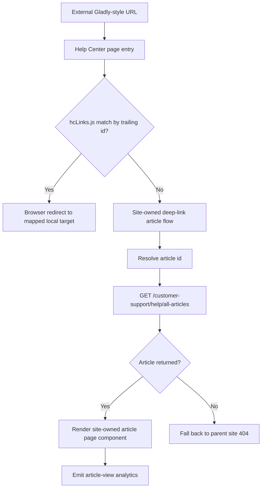

# Refactor Deep Linking Plan

## Architecture Overview

This refactor keeps the existing page-based Spring Boot + Vue help-center architecture intact while moving deep-link handling away from Gladly-controlled rendering and into site-controlled routing, redirect, and article rendering flows.



### Layered Structure
- **Page entry / routing layer**: existing help-center page entrypoints continue to initialize metrics, store state, and browser-side redirect logic.
- **Frontend redirect layer**: `useGladlyHcLinks` and `hcLinks.js` handle browser-side redirects for known legacy Gladly article links.
- **Frontend article-rendering layer**: a site-owned deep-link article component renders article content when no redirect applies.
- **API layer**: existing `/customer-support/help/all-articles` article retrieval contract is reused rather than replaced.
- **Analytics layer**: existing article-view analytics behavior is preserved using the current `metrics.link` pattern.
- **Fallback behavior**: unresolved deep links fall through to the parent site 404 page.

### Architectural Rationale
- Reuses existing repo patterns instead of introducing a new router or standalone deep-link subsystem.
- Preserves separation between browser-only redirect logic, page rendering, and API-backed article retrieval.
- Avoids unnecessary backend API expansion by reusing the existing article retrieval endpoint.
- Keeps analytics behavior aligned with the current help-center article flow.

## Technology Stack Justification

### Existing Frameworks and Libraries
- **Spring Boot / Spring MVC**: retains the current server-rendered page model and existing endpoint structure.
- **Vue**: deep-link rendering remains in the existing help-center frontend architecture.
- **Existing composables and store injection**: aligns with repo frontend guidance to reuse browser logic and injected page state.
- **Existing metrics integration**: preserves current `metrics.view` and `metrics.link` behavior instead of introducing a new tracking layer.

### Alignment with Constitution
- Reuses existing project patterns before introducing new abstractions.
- Preserves page-based SSR and client-entry architecture.
- Keeps presentation, API, and integration responsibilities separated.
- Avoids new third-party dependencies.

### Human Approval Flags
- None expected if the work stays within the current frontend, backend, and analytics patterns.
- Human approval would be required only if the implementation needs a new dependency, a new external integration, or a breaking route/API change.

## Folder Structure

### Expected Areas of Change
```text
.dev
.devin/
  plan.md
  specs/
    refactor-deep-linking.md
src/main/js/
  common/
    hcLinks.js
    composables/
      useGladlyHcLinks.ts
  pages/helpCenter/
    components/
      [new deep-link article component]
    composables/
      useArticleContent.ts
    entry-client.js
src/test or frontend test locations
  existing Vitest and/or Java test areas aligned with surrounding code
```

### Purpose of Major Areas
- `src/main/js/common/hcLinks.js`: static mapping for legacy Gladly-style deep links that should redirect to local site routes.
- `src/main/js/common/composables/useGladlyHcLinks.ts`: redirect logic executed on mount and for Gladly widget click interception.
- `src/main/js/pages/helpCenter/components/`: target location for the new site-owned article page component.
- `src/main/js/pages/helpCenter/composables/useArticleContent.ts`: existing article retrieval and analytics flow to preserve.
- `.devin/specs/`: source requirements for this refactor.
- `.devin/plan.md`: implementation plan derived from the approved spec.

## API Implementation Plan

### Reused Endpoint
#### `GET /customer-support/help/all-articles`
- Continue using the existing endpoint for article retrieval when a deep link resolves to an article instead of a redirect.
- Pass `articleIds` when the deep-link flow has resolved the target article identifier.
- Expect the current response shape to remain unchanged:

```json
[
  {
    "bodyHtml": "<div>...</div>",
    "id": "string",
    "name": "string"
  }
]
```

### Request / Response Handling
- If the deep-link flow has a valid article ID and no `hcLinks.js` redirect applies, request the article through the existing contract.
- If an article is returned, render it in the new site-owned article page component.
- If no article is returned, fall back to the parent site 404 page.

### Error Handling Approach
- Preserve existing endpoint-family behavior for API failures and avoid inventing a new error envelope.
- Keep controller/API behavior aligned with existing patterns.
- In the frontend, failed article retrieval should not silently succeed; it should lead to the defined not-found outcome when the article cannot be resolved.

## Testing Strategy

### Frontend Unit / Component Tests
- Add or update tests for `useGladlyHcLinks` behavior when:
  - a trailing Gladly identifier matches an `hcLinks.js` entry
  - no mapping exists
  - click interception occurs inside the Gladly widget
- Add tests for the new deep-link article component covering:
  - successful render when an article is returned
  - no competing in-page article-selection state
  - fallback behavior when no article is returned
- Add or update tests around article-view analytics to verify:
  - `metrics.link` is emitted
  - `pageName: ''`
  - `linkName` format is `${adobeName}_${camelCase(articleName)}`

### Integration / Flow Verification
- Verify an externally indexed Gladly-style URL that is mapped in `hcLinks.js` redirects to the configured local target.
- Verify an unmapped but valid article deep link renders through the site-owned component.
- Verify an unmapped and unresolved deep link falls through to the parent site 404 page.
- Verify analytics remain consistent with the current article flow.

### Test Data Approach
- Reuse existing article fixtures or mocks where available.
- Use representative Gladly-style query strings with known trailing identifiers from `hcLinks.js`.
- Mock article retrieval responses for success and empty-result cases.

## Assumptions Made

- The new deep-link article page can be implemented within the existing help-center page architecture without introducing a new frontend router.
- The existing `/customer-support/help/all-articles` contract is sufficient for deep-link article rendering.
- The parent site already owns and correctly renders the standard 404 page for unresolved deep links.
- Existing analytics consumers treat the current `metrics.link` article-view event as the required baseline.
- The markdown documentation required by the spec will be created separately from this plan and should describe redirect behavior, article rendering behavior, analytics behavior, and 404 fallback behavior.
